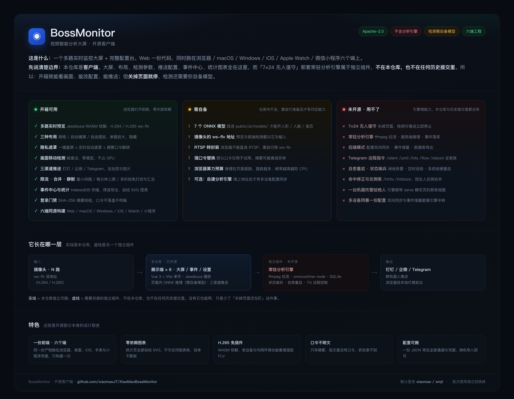

# BossMonitor · 视频智能分析大屏

> **这是客户端。** 大屏、布局、检测参数、推送配置、事件中心、统计图表、六端打包工程都在这里；负责「7×24 无人值守」的常驻分析引擎属于独立组件，**不在本仓库，也不在本仓库的任何历史提交里**。



| | |
|---|---|
| **开箱能做什么** | 多路实时预览、三种布局、隐私遮罩、三渠道推送（含限流/合并/免打扰）、事件中心与统计、登录门禁、六端同源构建 |
| **还差什么才能检测** | 7 个 ONNX 模型（自己导出后放进 `public/ai/models/`）——**没有模型时界面正常，只是不产生告警事件** |
| **不在这里的** | 常驻引擎：ffmpeg 拉流、服务端推理、SQLite 落库、状态哨兵、自愈重启、Telegram 远程指令 → **关掉页面就停** |

---

## 目录

- [一、快速开始](#一快速开始)
- [二、开箱可用的能力](#二开箱可用的能力)
- [三、需要自备的东西](#三需要自备的东西)
- [四、尚未开源的部分](#四尚未开源的部分)
- [五、整体架构](#五整体架构)
- [六、目录结构](#六目录结构)
- [七、技术栈](#七技术栈)
- [八、文档](#八文档)
- [九、版本历史](#九版本历史)
- [十、贡献与许可](#十贡献与许可)

---

## 一、快速开始

```bash
git clone https://github.com/xiaomaoJT/XiaoMaoBossMonitor.git
cd XiaoMaoBossMonitor
npm install
npm run dev            # http://127.0.0.1:5173
```

浏览器打开后是登录页，默认凭据：

| 账号 | 口令 |
|---|---|
| `xiaomao` | `xmjt` |

> ⚠️ **默认口令只用于第一次进去看，不要就这么用。** 它是 4 位、收录在任何字典里，而前端只存 `sha256(账号:口令)` 的摘要——摘要可以被离线穷举。换口令的方法见 [docs/登录鉴权方案.md](docs/登录鉴权方案.md) 第七章（一条 `node -e` 命令生成新摘要，替换 `src/config/auth.js` 后重新构建）。

登录后：设置 → 监控通道 → 填一个 ws-flv 地址（形如 `wss://host/live/camera1.flv`），保存并应用，画面就会出来。

想直接出静态产物带走：

```bash
npm run build          # 产出 dist/
npm run serve          # 起本地静态服务并打开浏览器（含钉钉/企微本地代理）
```

`npm run serve` 是**纯静态文件服务**，只把 `dist/` 发出去、顺带反代钉钉与企微两个外网接口。它不托管任何 API，所以事件同步、后端模式、远程指令都不可用。

---

## 二、开箱可用的能力

以下全部在浏览器里跑，不需要任何服务端。

### 画面与播放

| 能力 | 说明 |
|---|---|
| 多路实时预览 | 网格（自适应列数）/ 自动铺满 / 自由摆放（拖拽改位置尺寸） |
| H.265 ws-flv | 用 Jessibuca（WASM 软解）在浏览器内解码，无需插件 |
| 主 / 子码流切换 | 网格里多路同看自动拉子码流降压；点开放大单路切主码流 |
| 解码路数保护 | `maxDecode` 限制并发解码路数，超出自动排队 |
| 单路放大 / 隐藏 | 未隐藏的通道可随时恢复；顶栏一键「恢复全部」 |
| 隐私遮罩 | 一键盖住整屏，可设自动遮罩时长与解锁口令（遮罩期间画面可继续播）；解锁口令**只存摘要、界面不回显**（见 5.15） |
| 盲视模式（单路） | 隐藏这一路画面但**解码与检测照常跑**；底部操作条左下角眼睛图标一键切换；面板实时回答「还有没有在检测」与「这一路会推送到哪些渠道」（见 5.16） |
| 屏幕常亮 | Web / Electron / iOS 三端统一开关 |

### 浏览器端检测

> 这些依赖 `public/ai/models/` 里的模型，详见[第三章](#三需要自备的东西)。模型缺失时不报错，只是检测一直停在「未就绪」。

| 能力 | 实现 | 依赖模型 |
|---|---|---|
| 画面移动 | 帧差法，缩到 ~256px 灰度逐像素差分 | 无（零模型） |
| 人形识别 | YOLO 检测 COCO `person` | `yolo11n` / `yolo11s` |
| 人脸比对 | SCRFD 检测 + MobileFaceNet 512 维特征 + 余弦比对 | `scrfd-500m` + `mobilefacenet` |
| 外观属性 | 性别 / 年龄段 / 口罩 / 眼镜（墨镜优先判定） | `genderage` + `face_attrib_net` |
| 区域规则 | 进出 / 徘徊（纯几何，靠跨帧轨迹连续性） | 无 |
| 人员流向 | 同一人时间窗内先后离开 A 区域、进入 B 区域，可串联 A→B→C；零额外推理，复用已算好的 identity | 无 |
| 人形姿态 | 17 关键点 → 跌倒 / 举手 / 蹲下 | `yolov8n-pose` |
| 人员计数 | 按配置间隔播报当前 / 累计人数 | 复用跟踪器 |
| 未录入人脸收集 | 认不出的脸进「待录入」队列，可一键录入人脸库 | — |

> 四项扩展能力（人脸 / 姿态 / 区域 / 计数）有两层开关：**全局总闸**（`options.face.enabled` 等）和**通道级分流**（`cam.aiExt`）。总闸关着时通道级即使为 true 也不会动作 —— 这份判定集中在 `src/config/features.js`，纯函数零依赖。同一个文件还提供 `activeDetects()`（「这一路开了哪些检测」的全集），画面顶部芯片与盲视面板都从这里取，两处不可能一亮一灭。

### 推送与通知

- **三渠道**：钉钉（加签 + text/markdown）、企业微信（markdown + 图片 base64）、Telegram Bot（直接上传截图）。
- **各渠道独立限流**：`globalMinIntervalSec`（全局最小间隔）、`rateLimitPerMin`（每分钟上限）、超限合并策略（`merge` / `drop`）。
- **事件筛选**：按通道勾选推哪些事件类型、按最小面积比过滤。
- **免打扰（静默）**：支持多个时段（如 `20:00-08:00` + `12:00-13:30`），可选「每天 / 仅工作日 / 仅放假日」作用域，配合工作日历与法定节假日；静默开始与结束都发提醒，期间的事件**收存起来、结束时汇总推送**。也可以只静默其中几个渠道（见 5.6）。
- **通道静默**：只让指定的那一路在指定时段对指定渠道不推送。与整体静默是并集（见 5.6.2）。
- **消息模板**：三端排版可自定义并实时预览。
- **补图推送**：报警后补拍完整人形 / 人脸特写再补推一条。
- **系统通知**：Web Notification / Electron 原生通知 / iOS 本地通知。

> 钉钉与企业微信的开放接口没有 CORS 响应头，浏览器不能直连。`npm run dev` 与 `npm run serve` 都内置了 `/dingtalk-robot` 与 `/wecom-bot` 两个本地代理，Electron 端也有同款，所以推送在这三种跑法下都能用。Telegram 的 Bot API 允许跨域，直连即可。

### 其它

| 能力 | 说明 |
|---|---|
| 事件中心 | IndexedDB 存储（`useEventStore`），可筛选 / 详情 / 导出，支持放原图 |
| 统计面板 | KPI / 趋势 / 环形 / 分布 / 热力图 / 推送成功率，**图表全部自绘 SVG、零依赖**（见 5.21） |
| 人脸库 | IndexedDB 512 维向量 + 缩略图，同名归并与相似度去重 |
| 配置导入导出 | 整份 `.json` 带走全部通道、凭据与摆放坐标；载入只补缺，不覆盖非空 |
| 登录门禁 | 摘要校验、会话持久化、失败节流；口令不落盘、不传输 |
| 六端同源构建 | 一次构建产出 Web / macOS / Windows / iOS / Apple Watch / 小程序的同一份 `dist` |

---

## 三、需要自备的东西

| 项目 | 为什么需要 | 怎么补 |
|---|---|---|
| **7 个 ONNX 模型** | 浏览器端推理靠它们。**没有模型 → 界面正常，但零告警事件** | 见 [public/ai/models/README.md](public/ai/models/README.md)：用途、输入尺寸、许可证、导出命令都写在那 |
| **摄像头的 ws-flv 地址** | 预览与前端检测都以它为输入 | 由摄像头 / NVR / 流媒体服务提供 |
| **RTSP 转封装** | 浏览器不能直连 RTSP | 用 ffmpeg、ZLMediaKit、SRS 等转成 ws-flv |
| **强口令** | 默认 `xmjt` 的摘要可被离线穷举 | 生成新摘要替换 `src/config/auth.js` 的 `passwordHash` |
| 小程序 / iOS 的签名与域名 | 打包不等于上架 | 小程序需业务域名与 socket 合法域名；iOS 需开发者证书 |

> 模型为什么不放进仓库：`yolo11n` / `yolo11s` / `yolov8n-pose` 来自 Ultralytics，其官方声明「训练产出的模型权重同样归 **AGPL-3.0**」。分发这些权重会触发 AGPL 的开源义务，与本仓库的 Apache-2.0 不兼容，所以模型不进仓库、不进历史。自己获取与使用时，请自行遵守其原始许可证。

---

## 四、尚未开源的部分

以下能力属于常驻分析引擎（独立组件），**本仓库不含、历史提交里也没有**。列在这里是为了让边界清楚，不是为了宣传——它们不会因为你 clone 这个仓库而出现。

| 能力 | 缺了它的实际影响 |
|---|---|
| **7×24 无人值守** | 关掉浏览器标签页，检测与推送立即停止 |
| 常驻引擎（ffmpeg 拉流 → 服务端推理 → 事件落库） | 所有推理都发生在页面里，盒子一关就没了 |
| 后端模式（配置双向同步 / 事件增量拉取 / 数据库导出） | 多台设备各自一份配置，不互通 |
| Telegram 远程指令（`/silent` `/until` `/hits` `/flow` `/reboot` 等） | 手机上不能遥控，只能在页面里操作 |
| 状态哨兵、定时巡检、自愈重启、系统级硬重启 | 掉线不会主动告警，崩了不会自己起来 |
| 命中修正与反例库（`/hitfix` `/hitblock`、陌生人反例合并） | 认错了只能重新录入样本，无法把某张脸判为「不是他」 |
| 一台机器托管大屏给他人访问 | 没有「起一个服务，别人浏览器打开就能看」的那条链路 |
| 关键事件独立机器人 / 结算汇总分流 | 只有单一机器人，关键事件与日常事件混在同一个群 |

如果有一天你拿到这套引擎，前端会在「设置 → 检测识别 → 后端检测服务」里填上它的地址，之后配置与事件自动同步，界面上那些按钮才会真正连通。

---

## 五、整体架构

实线部分是本仓库独立可跑；虚线是需要另装的独立组件。


```
┌──────────────────────────────────────────────────────────────────────────┐
│                        展示端 × 6（同一份 dist）                            │
│                                                                            │
│  浏览器 / macOS(Electron) / Windows / iOS(Capacitor) / 小程序(web-view)     │
│    ├─ 大屏画面    CameraTile × N ── Jessibuca(WASM) ── 摄像头 ws-flv        │
│    ├─ 事件列表    EventPanel  ← IndexedDB(useEventStore)                    │
│    ├─ 设置抽屉    SettingsDrawer（18 个分页）                                │
│    └─ 页面内推理  aiWorker(ONNX Runtime Web) + 推送调度(useAlertPush)        │
└───────────────────────────────┬──────────────────────────────────────────┘
                                │ 可选：HTTP 双向同步（需要独立引擎，未开源）
                                ▼
┌ ─ ─ ─ ─ ─ ─ ─ ─ ─ ─ ─ ─ ─ ─ ─ ─ ─ ─ ─ ─ ─ ─ ─ ─ ─ ─ ─ ─ ─ ─ ─ ─ ─ ─ ─ ┐
   常驻分析引擎   headless-monitor      （独立组件，不在本仓库）
│                                                                           │
  摄像头流 ──ffmpeg──▶ JPEG 帧 ──onnxruntime-node──▶ 人形 / 人脸 / 姿态
│  事件 ──▶ 推送调度 ──▶ SQLite + 快照落盘                                     │
   旁路：状态哨兵 · 自愈重启 · Telegram 远程控制 · 静默查岗
└ ─ ─ ─ ─ ─ ─ ─ ─ ─ ─ ─ ─ ─ ─ ─ ─ ─ ─ ─ ─ ─ ─ ─ ─ ─ ─ ─ ─ ─ ─ ─ ─ ─ ─ ─ ┘
```

**一个设计取向：同一份逻辑，不让它漂移两份。** 能力开关、流向匹配、静默判定、推送调度都是纯函数或 composable，前端直接调用；引擎侧通过一层兼容层（补上 `window` / `document` / `localStorage`）复用同一批源码。所以钉钉的加签、企微的限流、消息模板、静默策略在两边行为天然一致。

---

## 六、目录结构

```
XiaoMaoBossMonitor/
├─ index.html                  入口 HTML（defer 引入 Jessibuca，避免白屏）
├─ vite.config.js              Vite 配置（构建时间戳注入 + 钉钉/企微本地代理）
├─ package.json                前端与六端构建的全部脚本
├─ capacitor.config.json       iOS 壳配置
├─ electron-builder.yml        macOS / Windows 桌面端打包配置
├─ LICENSE / NOTICE            Apache-2.0 正文与第三方组件声明
├─ CLA.md / CONTRIBUTING.md    贡献者许可协议与贡献流程
│
├─ src/                        ★ 前端源码
│  ├─ main.js                  Vue 挂载（挂的是 LoginGate，不是 App）
│  ├─ LoginGate.vue            登录门禁：会话有效才渲染 App
│  ├─ App.vue                  大屏主容器（布局 / 放大 / 事件流 / 各类调度）
│  ├─ components/
│  │  ├─ TopBar.vue            顶栏（布局切换 / 在线数 / 今日报警 / 入口按钮）
│  │  ├─ CameraTile.vue        单路画面（播放器 / 检测循环 / 区域绘制 / 芯片）
│  │  ├─ EventPanel.vue        事件列表（筛选 / 详情弹窗 / 导出）
│  │  ├─ SettingsDrawer.vue    设置抽屉（18 个分页，外壳在 settings/ 下按页拆）
│  │  ├─ StatsPanel.vue        统计面板（KPI / 趋势 / 环形 / 分布 / 热力图）
│  │  ├─ charts/               统计图表件 —— 全部自绘 SVG、零依赖（见 5.21）
│  │  ├─ LoginView.vue         登录页（玻璃风格 / 账号预填 / 保持登录 / 失败锁定）
│  │  ├─ AboutSystem.vue       关于系统（运行时长 / 推送统计 / 登录会话 / 设备信息）
│  │  └─ …                     模板编辑 / 隐私遮罩 / 通知栈 / 自定义下拉 / 说明气泡
│  ├─ composables/             37 个可复用逻辑单元，见下表
│  ├─ config/
│  │  ├─ defaults.js           两层配置：初始化配置 + 默认值（全部空白）
│  │  ├─ auth.js               本地校验型口令的**摘要**权威（登录 / 遮罩）+ 会话键 / 有效期 / 锁定阈值
│  │  └─ features.js           四项扩展能力的唯一权威判定（零依赖）
│  ├─ shared/                  前后端共用的纯函数（本仓库只被前端引用）
│  └─ workers/aiWorker.js      ONNX 推理 Worker
│
├─ public/                     构建期静态素材
│  ├─ js/jessibuca.js          Jessibuca 播放器（MIT）
│  ├─ js/decoder.wasm          软解 wasm
│  └─ ai/
│     ├─ ort/                  onnxruntime-web 的 wasm 运行时（MIT，必须保留）
│     └─ models/               ★ 空的，只留 README：模型需自备
│
├─ electron/                   Electron 主进程
│  ├─ main.cjs                 自定义协议 app://local + 静态服务 + 反向代理 + IPC
│  └─ preload.cjs              受控桥（屏幕常亮 / 通知 / 退出 / 重启）
│
├─ ios/                        Capacitor iOS 工程
│  └─ App/
│     ├─ App/                  WatchConnectivity 等原生插件
│     └─ MonitorWatch/         原生 SwiftUI 手表 App（看事件 + 标已读）
│
├─ miniprogram/                微信小程序壳（web-view 指向 H5）
│  ├─ pages/index              web-view 容器
│  └─ utils/config.js          ★ 要改的 H5_URL 在这里
│
├─ scripts/                    零依赖构建脚本（只用 Node 内置模块）
│  ├─ build-all.mjs            一条命令打全平台（只 build 一次，产物同源）
│  ├─ make-portable.mjs        便携版目录（拷走双击即用）
│  ├─ serve-static.mjs         便携版的本地静态服务（含两个推送代理）
│  ├─ build-mp.mjs             小程序体检（主包 ≤2MB / 总包 ≤20MB）
│  ├─ build-watch.mjs          watchOS 编译与手表注册
│  └─ electron-dev.mjs         Electron 热更新开发（自动拉起 vite）
│
├─ config/
│  ├─ config.example.json      配置格式示例（全是占位值）
│  └─ README.md                本地配置目录的用法约定
│
├─ docs/                       使用手册 / 远程控制方案 / 登录鉴权方案 / 示意图
└─ build/                      图标等打包资源
```

### `src/composables/` 速查

| 文件 | 职责 |
|---|---|
| `useJessibuca.js` | 按需等待播放器就绪（不再阻塞 App 挂载） |
| `useMotion.js` | 帧差法移动检测（零模型） |
| `useAiDetector.js` | 前端 ONNX 推理总入口（模型 / 人脸对齐 / 裁剪） |
| `useAiExtras.js` | 区域 / 徘徊 / 姿态 / 计数的编排 |
| `useTracker.js` | 轻量多目标跟踪器（纯几何，零模型） |
| `useFaceLib.js` | 人脸库（IndexedDB，512 维向量 + 缩略图） |
| `useFlowMatch.js` | 人员流向跨镜头配对（A 离场 → B 入场，可多跳） |
| `useEventStore.js` | 事件存储（IndexedDB，可放原图） |
| `useDailyStats.js` | 每日统计（不受事件条数淘汰影响） |
| `useAlertPush.js` | **推送调度核心**：三渠道路由 + 各自限流 + 超限合并 + 静默时段 |
| `useDingTalk.js` / `useWeCom.js` / `useTelegram.js` | 三个渠道的协议实现（加签 / 图片 / 模板正文） |
| `useMessageTemplate.js` | 推送模板引擎（三端排版统一） |
| `useAlarmText.js` | 报警文案统一收口（8 种事件类型的标题） |
| `useImageHost.js` | 零配置图床（把截图换成公网 URL，钉钉 markdown 需要） |
| `usePushStats.js` | 推送统计（三端分开 + 累计） |
| `useSystemNotify.js` | 系统通知（Web / Electron / iOS 三端统一） |
| `useDeviceInfo.js` | 运行设备信息（推送里写清「哪条链路发出来的」） |
| `useWatchBridge.js` | Apple Watch 桥接（节流推送事件 + 接回执指令） |
| `useAuth.js` | **登录门禁**：本地摘要校验、会话持久化、失败节流 |
| `sha256.js` | 纯 JS SHA-256（局域网 http 下没有 `crypto.subtle`，必须自带） |
| `useSystemUptime.js` | 系统运行时长（含中断统计 + 落盘） |
| `useWakeLock.js` / `useAppExit.js` / `useFileIO.js` / `useNet.js` / `useErrorLog.js` | 常亮 / 退出 / 导入导出 / 超时 fetch / 错误留档 |
| `useBackendSync.js` / `useBackendEvents.js` | 后端模式客户端（默认关闭；需要独立引擎才生效） |

---

## 七、技术栈

| 层 | 选型 |
|---|---|
| 前端框架 | Vue 3（组合式 API）+ Vite 6，**无路由、无状态库**，全部逻辑收在 composable |
| 实时播放 | Jessibuca（WASM 软解，H.264 / H.265，ws-flv） |
| AI 推理 | ONNX Runtime Web（wasm / WebGPU），跑在 Web Worker |
| 存储 | IndexedDB（事件 + 人脸库 + 每日统计） |
| 桌面端 | Electron + electron-builder |
| 移动端 | Capacitor（iOS）+ 原生 SwiftUI（watchOS） |
| 小程序 | 微信小程序 web-view 壳 |
| 构建脚本 | 纯 Node 内置模块，零依赖 |

运行时依赖只有 `vue` 与 `@capacitor/*` 四个包；图表、SHA-256、跟踪器、模板引擎全部自写，没有第三方运行时依赖。

---

## 八、文档

| 文档 | 内容 |
|---|---|
| [docs/使用手册.md](docs/使用手册.md) | 各端运行方式、配置说明、操作教程、常见问题，以及运行逻辑设计附录（5.1–5.80） |
| [docs/登录鉴权方案.md](docs/登录鉴权方案.md) | 威胁模型、存/传/比三层设计、会话与失败节流、换口令方法，以及**哪些威胁其实没挡住** |
| [docs/远程控制方案.md](docs/远程控制方案.md) | 推送通道远程控制的方案设计与踩坑记录（依赖常驻引擎，本仓库不可用） |
| [public/ai/models/README.md](public/ai/models/README.md) | 7 个模型的用途、输入尺寸、许可证与获取方式 |

> 手册里有相当篇幅在讲引擎侧的实现（HTTP API、环境变量、远程指令、自愈重启）。这些是**设计记录**，读完能理解整套系统怎么协作，但对应的功能不在本仓库里。凡涉及引擎的段落，手册都标注了「引擎侧」。

源码注释里出现的 `server/xxx.mjs` 指向引擎内部实现，仅作设计说明，本仓库中不存在对应文件。

---

## 九、版本历史

每次发版的变更记录（新增 / 优化 / 修复，按语义化版本 SemVer 组织；版本号权威来源是 `src/config/defaults.js` 的 `BRAND.version`）。

→ **[CHANGELOG.md](CHANGELOG.md)**

## 十、贡献与许可

**贡献**：提交 PR 前必须签署贡献者许可协议（CLA），一次签署对此后所有贡献长期有效。开发环境、三条铁律（绝不提交凭据、不擅自换模型、改动动到判定逻辑要同步前后端）与提交规范见：

→ **[CONTRIBUTING.md](CONTRIBUTING.md)** · **[CLA.md](CLA.md)** · **[CLA 签署台账](CLA-SIGNATURES.md)**

**许可**：本仓库以 **Apache-2.0** 发布，可商用、可闭源集成，附带专利授权与商标条款。第三方组件见 [NOTICE](NOTICE)。

需要说清的一处边界：Apache-2.0 只覆盖**本仓库里的代码**。`yolo11n` / `yolo11s` / `yolov8n-pose` 等 Ultralytics 权重是 **AGPL-3.0**，不在本仓库内；你自己获取并使用它们时，需要自行遵守 Ultralytics 的许可（商业用途通常需要其 Enterprise License）。这条与「本项目开不开源」是两件事。

---

*BossMonitor · 开源客户端。单独部署即可看画面、改配置、发推送；需要 7×24 值守与远程控制时，请另行部署分析引擎。*
