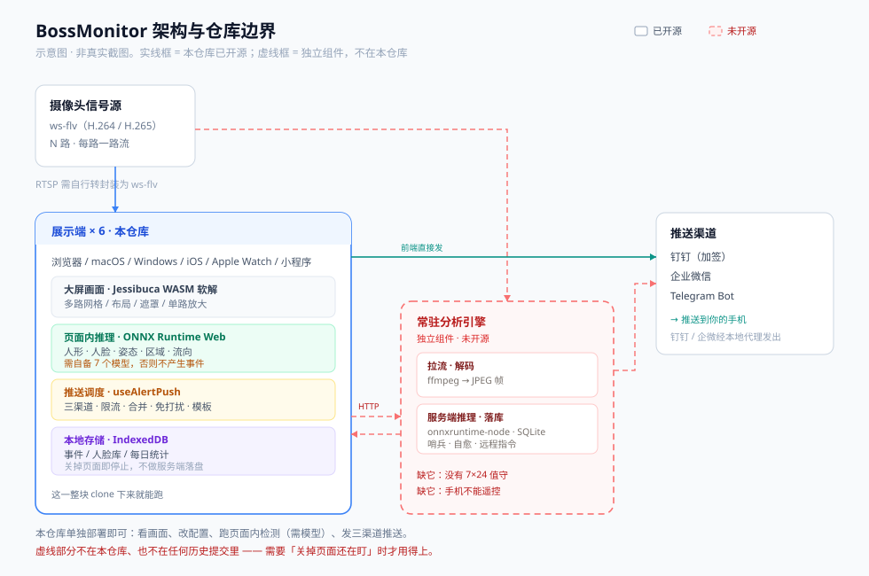

# BossMonitor · 视频监控多路实时预览大屏

> 一个「大屏看画面 + 后台常驻盯人 + 出事推到手机」的完整监控系统。
> Web 一份代码，同时跑在 **浏览器 / macOS 桌面端 / Windows / iOS / Apple Watch / 微信小程序** 六个端上。

> 📖 **使用与运维文档已拆分到 [docs/使用手册.md](docs/使用手册.md)** —— 快速上手、各端运行方式、配置说明、操作教程（区域 / 人脸库 / 人员流向 / 静默 / 多端同步）、远程指令、HTTP API、环境变量、常见问题排障。
> 本页只保留系统介绍与架构。文中出现的「见 5.x」编号对应《使用手册》末尾附录「运行逻辑」，**编号未变**。

---

## 目录

- [一、这是什么](#一这是什么)
- [二、核心能力](#二核心能力)
- [三、整体架构](#三整体架构)
- [四、目录结构](#四目录结构)
- [五、技术栈](#五技术栈)
- [六、使用手册](#六使用手册)
- [七、远程控制方案](#七远程控制方案)
- [八、登录鉴权方案](#八登录鉴权方案)

---

## 一、这是什么

BossMonitor 最初是一个「7 路摄像头铺满一块大屏」的网页，后来长成了下面这套东西：

- **一块大屏**：多路实时画面（H.265 ws-flv 也能解），支持网格 / 自动铺满 / 自由摆放三种布局、单路放大、隐藏、隐私遮罩。
- **一个检测大脑**：画面移动、人形识别、**人脸识别（可建人脸库）**、**区域进出 / 徘徊**、**人形姿态（跌倒 / 举手 / 蹲下）**、**人员计数**。
- **一条推送链路**：钉钉群机器人 / 企业微信群机器人 / Telegram Bot 三端，带限流、合并、免打扰时段、静默期汇总。
- **一个常驻后端**：`server/` 下的 headless 服务 —— **把所有页面关掉，它照样在盯人、照样在推送**。
- **一套远程遥控**：在手机上私聊 Telegram 机器人发指令，就能静默推送、查岗要截图、重启服务，甚至重启整台机器。**静默哪些渠道可选** —— 默认只静默钉钉 + 企微（TG 留着收发指令），临时想改就在指令里写（`/silent 2 wecom`），长期想改在设置页配（见 5.6.1）。

核心设计取向：**同一份逻辑，不让它漂移两份**。前端和 Node 后端跑的是**同一批 composable 源码**（靠一层 `compat.mjs` 补上 `window` / `document` / `localStorage`），所以钉钉的加签、企微的限流、消息模板、静默策略在两边的行为天然一致。

---

## 二、核心能力

### 画面与播放

| 能力 | 说明 |
|---|---|
| 多路实时预览 | 网格（自适应列数）/ 自动铺满 / 自由摆放（拖拽改位置尺寸） |
| H.265 ws-flv | 用 Jessibuca（WASM 软解）在浏览器内解码，无需插件 |
| 主 / 子码流切换 | 网格里多路同看自动拉子码流降压；点开放大单路切主码流 |
| 解码路数保护 | `maxDecode` 限制并发解码路数，超出自动排队 |
| 单路放大 / 隐藏 | 未隐藏的通道可随时恢复；顶栏一键「恢复全部」 |
| 隐私遮罩 | 一键盖住整屏，可设自动遮罩时长与解锁密码（遮罩期间画面可继续播）；解锁密码**只存摘要、界面不回显**（见 5.15） |
| 盲视模式（单路） | 隐藏这一路画面但**解码与检测照常跑**；底部操作条左下角眼睛图标一键切换（常用，已从「更多」菜单提出）；面板实时回答「还有没有在检测」（任意一项检测开着即算在跑）与「这一路会推送到哪些渠道」（见 5.16） |
| 屏幕常亮 | Web / Electron / iOS 三端统一开关，挂机值守必备 |

### 检测与分析

| 能力 | 实现 | 依赖模型 |
|---|---|---|
| 画面移动 | 帧差法，缩到 ~256px 灰度逐像素差分 | 无（零模型） |
| 人形识别 | YOLO 检测 COCO `person` | `yolo11n` / `yolo11s` |
| 人脸识别 | SCRFD 检测 + MobileFaceNet 512 维特征 + 余弦比对 | `scrfd-500m` + `mobilefacenet` |
| 区域规则 | 进出 / 徘徊（纯几何，靠跨帧轨迹连续性） | 无 |
| 人员流向 | 同人在时间窗内先后离开 A 区域、进入 B 区域（可串联 A→B→C），判定一次「走向」事件；零额外推理，只复用已算好的人脸 identity | 无（默认人脸档） |
| 人形姿态 | 17 关键点 → 跌倒 / 举手 / 蹲下 | `yolov8n-pose` |
| 人员计数 | 按配置间隔播报当前 / 累计人数 | 复用跟踪器 |
| 未录入人脸收集 | 认不出的脸自动进「待录入」队列，可一键录入人脸库 | — |
| 命中修正 | 列出最近 20 条已入库命中（带原图），认错了按正确名字重新录入样本，提升后续识别精准度（仅后端模式）；远程指令四件套 `/hit` `/hitfix` `/hitblock` `/hitignore` 可在手机上按时刻查样本并修正（见 5.56） | — |
| 不是本人（反例） | 命中卡片一键把「陌生人被误认成某人」的脸标成反例，之后同一张脸直接判未录入；可查可解除（仅后端模式） | — |

> 四项扩展能力（人脸 / 姿态 / 区域 / 计数）有两层开关：**全局总闸**（`options.face.enabled` 等）和**通道级分流**（`cam.aiExt`）。总闸关着时，通道级即使为 true 也不会有动作 —— 这一份判定集中在 `src/config/features.js`，前后端共用，不会出现「画面上显示开了、推送里说没开」。
>
> 同一个文件还提供 `activeDetects()` —— 「这一路开了哪些检测」的**全集**（画面变动 / 人形 / 人脸 / 姿态 / 区域 / 计数）。画面顶部的检测芯片与盲视面板的「检测运行中」都从这里取，两处不可能一个亮一个灭（见 5.16）。

### 推送与通知

- **三渠道**：钉钉（加签 + text/markdown）、企业微信（markdown + 图片 base64）、Telegram Bot（直接上传截图）。
- **各渠道独立限流**：`globalMinIntervalSec`（全局最小间隔）、`rateLimitPerMin`（每分钟上限）、超限合并策略（`merge` / `drop`）。
- **事件筛选**：按通道勾选推哪些事件类型（移动 / 人形 / 人脸 / 区域 / 姿态 / 计数）、按最小面积比过滤。
- **免打扰（静默）**：支持多个时段（如 `20:00-08:00` + `12:00-13:30`）和临时静默（`/silent 2`、`/until 08:00`），静默开始/结束都发提醒，静默期间的报警**收存起来、结束时汇总推送**。静默**可以只静默其中几个渠道**（默认钉钉 + 企微，刻意不含 TG —— 见 5.6）。
- **通道静默**：只让**指定的那一路**在指定时段对指定渠道不推送（`/csilent 门口 2`，或设置 → 监控通道 → 该路的「通道静默」）。与上面的整体静默是**并集**：任一命中即静默；一条事件同时被两边覆盖时只进整体汇总，不重复。三处刻意与整体静默不同（零报警不发汇总 / 只发给被静默的渠道 / 不发开始提醒）—— 见 5.6.2。
- **消息模板**：三端排版可自定义并实时预览（`推送模板` 页）。
- **关键事件单独提醒**（可选，默认关）：静默提醒 / 静默汇总 / 人脸命中三类事件，除正常渠道外**再私聊推给指定 TG 用户**（授权用户 + 额外 id）。人脸命中**不受静默影响** —— 见 5.5.1。
- **关键事件独立机器人**（钉钉 / 企微各一个，默认关）：另配一个 Webhook 把关键事件单独打到另一个群；「结算汇总只走关键事件」开关可去掉免打扰结束时两个机器人各推一条同款汇总的重复 —— 见 5.55。
- **补图推送**：报警后补拍完整人形 / 人脸特写再补推一条。
- **状态巡检**：通道掉线推「监控异常」，恢复推「监控恢复」，持续异常按间隔重复提醒；另有定时巡检报告。
- **系统通知**：Web Notification / Electron 原生通知 / iOS 本地通知，三端统一封装。

## 三、整体架构



下面这张组件图给出更细的模块划分：

```
┌──────────────────────────────────────────────────────────────────────────┐
│                            展示端（同一份 frontend）                       │
│                                                                            │
│  浏览器 / macOS(Electron) / Windows / iOS(Capacitor) / 小程序(web-view)     │
│    ├─ 大屏画面    CameraTile × N ── Jessibuca(WASM) ── 摄像头 ws-flv/rtsp    │
│    ├─ 事件列表    EventPanel  ← IndexedDB(useEventStore)                    │
│    ├─ 设置抽屉    SettingsDrawer（14 个分页）                                │
│    └─ 纯前端模式下的检测与推送（默认；后端模式开启后本地停掉）                  │
└───────────────────────────────┬──────────────────────────────────────────┘
                                │ POST /api/config（把配置整体推给后端）
                                │ GET  /api/events（拉后端事件增量）
                                ▼
┌──────────────────────────────────────────────────────────────────────────┐
│                    常驻后端  server/headless-monitor.mjs                    │
│                                                                            │
│  摄像头流 ──ffmpeg──▶ JPEG 帧 ──onnxruntime-node──▶ 人形框                   │
│                              ├─ Tracker（复用前端 useTracker）──▶ 区域/徘徊/计数│
│                              ├─ SCRFD + MobileFaceNet ──▶ 人脸比对            │
│                              └─ YOLOv8n-pose ──▶ 姿态动作                     │
│                                                                            │
│  事件 ──▶ 推送调度（复用前端 useAlertPush 全套：三渠道 / 限流 / 合并 / 静默）    │
│       ──▶ SQLite(server/data/monitor.db) + 快照(server/data/shots/)          │
│                                                                            │
│  旁路：状态哨兵 watchdog（掉线告警 + 定时巡检）                                │
│        自愈重启 restart.mjs（端口释放→spawn→自检→回滚）                        │
│        系统级硬重启 hard-reboot.mjs（最后手段，默认关）                         │
│        Telegram 远程控制 tg-remote.mjs（getUpdates 长轮询）                    │
│        静默查岗 duty-check.mjs（/check duty）                                 │
└──────────────────────────────────────────────────────────────────────────┘
```

**为什么后端也要起一个 HTTP 服务**：它同时充当三件事 —— ① 给前端拉事件 / 推配置的 API；② 把 `dist/` 静态页直接 serve 出去（所以一台机器只跑 `npm run server`，浏览器打开 `http://<ip>:8787` 就能看大屏）；③ 钉钉 / 企微 / Telegram 的**反向代理**（官方接口都没有 CORS 响应头，浏览器直连必被拦）。

## 四、目录结构

```
Monitor/
├─ index.html                  入口 HTML（defer 引入 Jessibuca，避免白屏）
├─ vite.config.js              Vite 配置（构建时间戳注入 + 钉钉/企微本地代理）
├─ package.json                全部 npm 脚本入口
├─ CHANGELOG.md                版本历史（语义化版本，见 §5.29）
├─ capacitor.config.json       iOS 壳配置（appId com.mao.monitorwall）
├─ electron-builder.yml        macOS / Windows 桌面端打包配置
├─ start-windows.bat           Windows 一键启动后端（双击即用）
│
├─ src/                        ★ 前端源码（前后端共享）
│  ├─ main.js                  Vue 挂载（挂的是 LoginGate，不是 App）
│  ├─ LoginGate.vue            ★ 登录门禁：会话有效才渲染 App（未登录不实例化大屏）
│  ├─ App.vue                  大屏主容器（布局 / 放大 / 事件流 / 各类调度）
│  ├─ style.css
│  ├─ components/
│  │  ├─ TopBar.vue            顶栏（布局切换 / 在线数 / 今日报警 / 入口按钮）
│  │  ├─ CameraTile.vue        单路画面（播放器 / 检测循环 / 区域绘制 / 芯片）
│  │  ├─ EventPanel.vue        事件列表（筛选 / 详情弹窗 / 导出）
│  │  ├─ SettingsDrawer.vue    设置抽屉（14 个分页：监控通道 / 播放性能 / 检测识别 / 报警提醒 / 推送模板 / 钉钉 / TG / 企微 / 状态巡检 / 系统维护 / 配置方案 / 隐私遮罩 / 外观 / 关于系统）
│  │  ├─ StatsPanel.vue        ★ 统计面板（KPI / 趋势 / 环形 / 分布 / 热力图 / 推送成功率）
│  │  ├─ charts/               ★ 统计页图表件 —— 全部自绘 SVG、零依赖、零 hex（见 5.21）
│  │  │  ├─ scale.js           纯函数几何（niceTicks / tickTop / ratio / heatOpacity / fmtInt / fmtHour）
│  │  │  ├─ ChartFrame.vue     坐标系骨架（网格 / y 刻度 / x 标签 / slot 比例函数）
│  │  │  ├─ TrendArea.vue      面积 + 折线 + 数据点
│  │  │  ├─ DonutShare.vue     环形占比（描边圆 + dasharray）
│  │  │  ├─ DistBars.vue       类型分布横条（统一刻度尺 + 百分比列）
│  │  │  ├─ PushStack.vue      三端推送成功 / 失败堆叠 + 成功率刻度
│  │  │  ├─ HeatGrid.vue       7 天 × 24 小时热力图（两个分类轴）
│  │  │  └─ SparkLine.vue      KPI 卡内嵌迷你折线
│  │  ├─ PushTemplatePanel.vue 推送模板编辑与预览
│  │  ├─ PrivacyMask.vue       隐私遮罩层
│  │  ├─ NotifyStack.vue       左上角通知卡片栈
│  │  ├─ LoginView.vue         ★ 登录页（玻璃风格 / 账号预填 / 保持登录 / 失败锁定）
│  │  ├─ AboutSystem.vue       关于系统（运行时长 / 推送统计 / 登录会话 / 设备信息）
│  │  ├─ SelectField.vue       自定义下拉（弹层可点选）
│  │  └─ InfoTip.vue           说明气泡
│  ├─ composables/             29 个可复用逻辑单元，见下表
│  ├─ config/
│  │  ├─ defaults.js           两层配置：初始化配置 + 内置隐藏配置
│  │  ├─ auth.js               本地校验型口令的**摘要**权威（登录 / 遮罩 / 内置配置口令）+ 会话键 / 有效期 / 锁定阈值（见 5.15）
│  │  └─ features.js           四项扩展能力的唯一权威判定（零依赖，前后端共用）
│  └─ workers/aiWorker.js      ONNX 推理 Worker（前端用）
│
├─ server/                     ★ 常驻后端（Node，无框架）
│  ├─ headless-monitor.mjs     主服务：HTTP API / 配置热更新 / 全链路编排（约 2120 行）
│  ├─ analyzer.mjs             每路一个分析器：跟踪 / 区域 / 人脸 / 姿态 / 计数
│  ├─ detector.mjs             ONNX 推理（onnxruntime-node），按「槽位」区分模型
│  ├─ source.mjs               流 → JPEG 帧管道（ffmpeg；ws-flv 走 ws 灌 stdin）
│  ├─ watchdog.mjs             状态哨兵：掉线告警 + 定时巡检
│  ├─ notify.mjs               推送调度（转发到前端 useAlertPush）
│  ├─ store.mjs                SQLite 存储层（事件 / 人脸库 / 待录入 / 命中样本 / kv 游标）
│  ├─ face-lib.mjs             人脸库（512 维向量 + 内存缓存 + 余弦比对）
│  ├─ imageops.mjs             纯 JS 位图 + 最小 Canvas 2D 实现（给 alignFace 用）
│  ├─ compat.mjs               Node 兼容层（window / document / localStorage）
│  ├─ auth.mjs                 ★ 登录鉴权（一次性 nonce / 摘要校验 / 会话 token / 失败锁定）
│  ├─ tg-remote.mjs            Telegram 远程控制（指令表 / 解析 / 长轮询 / 游标落盘）
│  ├─ tg-guard.mjs             远程重启熔断（落盘计数，防重启死循环）
│  ├─ duty-check.mjs           静默查岗（/check duty）
│  ├─ restart.mjs              自愈重启器（端口释放 → spawn → 自检 → 回滚）
│  ├─ hard-reboot.mjs          系统级硬重启（三平台命令 + 权限检测）
│  ├─ ffmpeg-fetch.mjs         ffmpeg 自动获取（首次运行自动下载 ≥7 版本）
│  ├─ ffmpeg-fetch-cli.mjs     预取 ffmpeg 的命令行入口
│  ├─ logstamp.mjs             给所有 console 输出加 [HH:mm:ss] 前缀
│  ├─ config.json              后端的落盘配置（运行时数据，可删）
│  └─ data/                    运行期数据（已 gitignore）
│     ├─ monitor.db            SQLite：事件 / 人脸库 / 待录入 / 命中样本 / kv
│     ├─ shots/                事件快照 JPEG
│     ├─ restart.log / .json   重启日志与台账
│     ├─ tg-offset.json        TG 指令游标（重启不重放积压，见 5.12）
│     ├─ tg-reboot.json        远程重启熔断台账（见 5.12）
│     ├─ auth-sessions.json    登录会话（只存 token 的哈希，重启不踢人；见 5.14）
│     └─ localstorage.json     推送统计的持久化（shim 出来的 localStorage）
│
├─ public/                     构建期静态素材
│  ├─ js/jessibuca.js          469KB 播放器（defer 引入）
│  ├─ js/decoder.wasm          软解 wasm
│  └─ ai/models/               107MB ONNX 模型（会被复制进 dist/ai）
│
├─ electron/                   Electron 主进程
│  ├─ main.cjs                 自定义协议 app://local + 静态服务 + 反向代理 + IPC
│  └─ preload.cjs              受控桥（屏幕常亮 / 通知 / 退出 / 重启）
│
├─ ios/                        Capacitor iOS 工程
│  └─ App/App/
│     ├─ WatchBridgePlugin.swift  WatchConnectivity 桥
│     ├─ MonitorExtrasPlugin.swift
│     └─ public/                  同步进来的 H5 产物
│  └─ App/MonitorWatch/          原生 SwiftUI 手表 App（看事件 + 标已读）
│
├─ miniprogram/                微信小程序壳（web-view 指向 H5）
│  ├─ pages/index              web-view 容器
│  ├─ pages/guide              未配置 H5 地址时的引导页
│  └─ utils/config.js          ★ 要改的 H5_URL 在这里
│
├─ scripts/                    零依赖构建脚本（只用 Node 内置模块）
│  ├─ build-all.mjs            一条命令打全平台（只 build 一次，产物同源）
│  ├─ make-portable.mjs        便携版目录（拷走双击即用）
│  ├─ make-win-deploy.mjs      Windows 部署包（含 node_modules）
│  ├─ serve-static.mjs         便携版的本地静态服务（含三个代理）
│  ├─ build-mp.mjs             小程序体检（主包 ≤2MB / 总包 ≤20MB）
│  ├─ build-watch.mjs          watchOS 编译与手表注册
│  └─ electron-dev.mjs         Electron 热更新开发（自动拉起 vite）
│
├─ docs/
│  └─ 远程控制方案.md           远程控制的方案设计与踩坑记录
│
├─ build/                      图标等打包资源
├─ dist/                       构建产物（含 ai 模型，共约 113MB）
└─ release/                    打包产物（桌面端 / 便携版 / 部署包，已 gitignore）
```

### `src/composables/` 速查

| 文件 | 职责 |
|---|---|
| `useJessibuca.js` | 按需等待 469KB 播放器就绪（不再阻塞 App 挂载） |
| `useMotion.js` | 帧差法移动检测（零模型） |
| `useAiDetector.js` | 前端 ONNX 推理总入口（模型 / 人脸对齐 / 裁剪） |
| `useAiExtras.js` | 区域 / 徘徊 / 姿态 / 计数的编排 |
| `useTracker.js` | 轻量多目标跟踪器（纯几何，零模型，**后端复用**） |
| `useFaceLib.js` | 人脸库（IndexedDB，512 维向量 + 缩略图） |
| `useEventStore.js` | 事件存储（IndexedDB，可放原图） |
| `useDailyStats.js` | 每日统计（不受事件条数淘汰影响） |
| `useAlertPush.js` | **推送调度核心**：三渠道路由 + 各自限流 + 超限合并 + 静默时段 |
| `useDingTalk.js` / `useWeCom.js` / `useTelegram.js` | 三个渠道的协议实现（加签 / 图片 / 模板正文） |
| `useMessageTemplate.js` | 推送模板引擎（三端排版统一） |
| `useAlarmText.js` | 报警文案统一收口（8 种事件类型的标题） |
| `useImageHost.js` | 零配置图床（把截图换成公网 URL，钉钉 markdown 需要） |
| `usePushStats.js` | 推送统计（三端分开 + 累计） |
| `useSystemNotify.js` | 系统通知（Web / Electron / iOS 三端统一） |
| `useDeviceInfo.js` | 运行设备信息（推送里写清「哪条链路发出来的」） |
| `useBackendSync.js` / `useBackendEvents.js` | 后端模式的配置同步（**推 `POST /api/config` + 拉 `GET /api/config`**，含 `localRev` 与推送指纹）与事件轮询 |
| `useWatchBridge.js` | Apple Watch 桥接（节流推送事件 + 接回执指令） |
| `useAuth.js` | **登录门禁**：本地兜底 + 服务端 challenge/proof 校验、会话持久化、失败节流 |
| `sha256.js` | 纯 JS SHA-256（局域网 http 下没有 `crypto.subtle`，必须自带；与 node:crypto 对拍过） |
| `useSystemUptime.js` | 系统运行时长（含中断统计 + 落盘，前后端共用） |
| `useWakeLock.js` / `useAppExit.js` / `useFileIO.js` / `useNet.js` / `useErrorLog.js` | 常亮 / 退出 / 导入导出 / 超时 fetch / 错误留档 |

## 五、技术栈

| 层 | 选型 |
|---|---|
| 前端框架 | Vue 3（组合式 API）+ Vite 6，**无路由、无状态库**，全部逻辑收在 composable |
| 实时播放 | Jessibuca（WASM 软解，H.264 / H.265，ws-flv） |
| AI 推理（前端） | ONNX Runtime Web（wasm / WebGPU），跑在 Web Worker |
| AI 推理（后端） | onnxruntime-node |
| 模型 | `yolo11n` / `yolo11s`（人形）、`scrfd-500m`（人脸检测）、`mobilefacenet`（人脸特征）、`yolov8n-pose`（姿态） |
| 后端 | Node 原生 `http` + `ws`，无 Web 框架 |
| 存储（后端） | better-sqlite3（WAL 模式），快照落磁盘 |
| 存储（前端） | IndexedDB（事件 + 人脸库） |
| 图像处理 | `jpeg-js` + 自实现的位图与最小 Canvas 2D（`imageops.mjs`） |
| 视频解码 | ffmpeg（≥7，首次运行自动下载到 `server/.cache/`） |
| 桌面端 | Electron 44 + electron-builder |
| 移动端 | Capacitor 8（iOS）+ 原生 SwiftUI（watchOS） |
| 小程序 | 微信小程序 web-view 壳 |
| 构建脚本 | 纯 Node 内置模块，零依赖 |

---

## 六、使用手册

面向**使用与运维**的完整手册：快速上手、各端运行方式、配置说明、操作教程（区域 / 人脸库 / 人员流向 / 静默 / 多端同步）、远程指令、HTTP API、环境变量、常见问题排障，以及运行逻辑设计附录（5.1–5.58，代码注释里的「见 5.x」都指这里）。

→ **[docs/使用手册.md](docs/使用手册.md)**

## 七、远程控制方案

远程控制的方案设计、安全边界与踩坑记录（含自愈重启的五处根因、查岗的实现取舍）。

→ **[docs/远程控制方案.md](docs/远程控制方案.md)**

## 八、登录鉴权方案

登录门禁的威胁模型、存/传/比三层设计、会话与失败节流，以及**哪些威胁其实没挡住**。

→ **[docs/登录鉴权方案.md](docs/登录鉴权方案.md)**

---

*BossMonitor · 仅供自用部署。涉及远程重启 / 系统级硬重启的能力默认关闭，开启前请确认权限与开机自启已就绪。*
